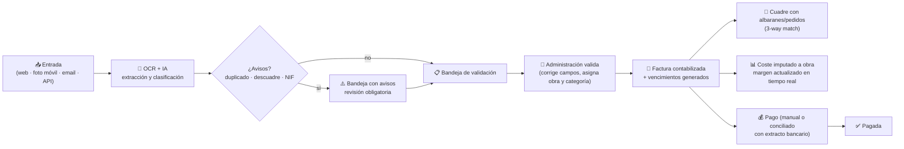
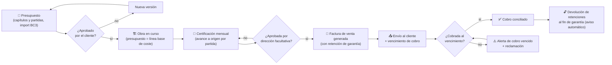
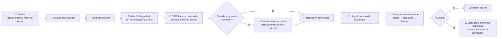
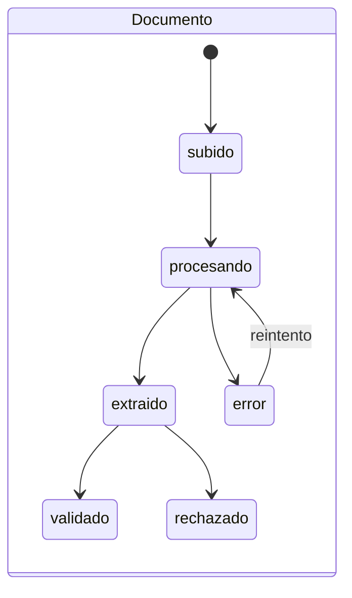
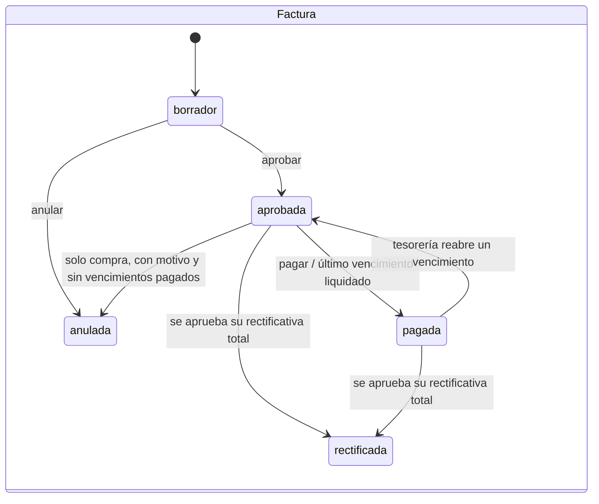
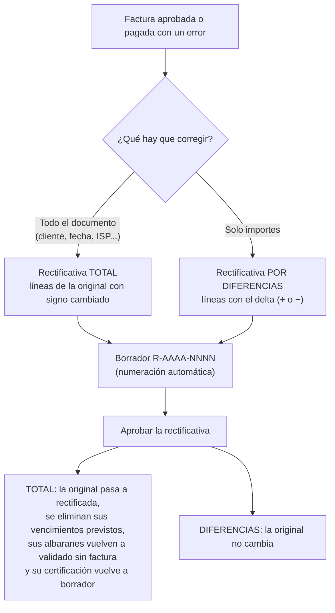

# 04 · Flujos de Trabajo

Los cuatro circuitos operativos que cubren el día a día de una constructora, más los procesos automáticos de fondo.

## F1 · Circuito de gasto (factura de compra)

Reglas:
- Un documento nunca se convierte en apunte económico sin validación humana (salvo que el usuario active auto-validación para extracciones con confianza > 98% y sin avisos).
- La factura vencida sin pagar pasa automáticamente a `vencida` y genera alerta.
- El rol `obra` puede subir la foto del ticket/albarán; la validación económica queda siempre en `administracion`/`gerente`.

## F2 · Circuito de ingreso (presupuesto → certificación → cobro)

## F3 · Circuito de compras (pedido → albarán → factura)

## F4 · Ciclo mensual de gestión

| Día | Proceso | Automático / Manual |
|---|---|---|
| Continuo | Entrada y validación de documentos; conciliación bancaria diaria | Mixto |
| Día 1 | Refresco de cierre del mes anterior; **informe mensual automático** (P&L, IVA, obras) enviado a gerencia | Automático |
| Días 1-5 | Certificaciones de obra del mes anterior → facturas de venta | Manual asistido |
| Día 5 | Aviso de vencimientos de la semana + previsión de caja a 30/60/90 | Automático |
| Días 15/20 | Revisión de desviaciones presupuesto vs. real por obra (alertas si > umbral) | Automático |
| Trimestre | Export libro de IVA + facturas para la asesoría (Excel/PDF) | Automático programable |

## F5 · Procesos automáticos de fondo (workers)

| Worker | Disparo | Acción |
|---|---|---|
| `ocr-extraction` | Evento `documento.subido` | OCR + extracción + clasificación + dedupe |
| `alerts-due` | Cron diario 07:00 | Vencidos e impagados → alertas + email |
| `cashflow-forecast` | Cron diario + al registrar pagos | Recalcula proyección de caja; alerta si < umbral |
| `bank-sync` | Cron cada 6h | Descarga movimientos PSD2 y propone conciliaciones |
| `budget-deviation` | Al imputar coste a obra | Recalcula desviación por capítulo; alerta si > X% |
| `monthly-report` | Cron día 1 | Genera y envía informe de cierre (PDF/Excel) |
| `backup-verify` | Cron semanal | Comprueba integridad de backups y restauración de muestra |
| `retention-reminder` | Cron diario | Avisa de retenciones de garantía recuperables |

## F6 · Estados y transiciones clave

Los estados `rectificada` y `anulada` son terminales. `rectificada` sigue siendo un documento fiscal válido (cuenta en el coste y en el libro de IVA junto a su rectificativa, que resta); `anulada` es "no cuenta".

## F7 · Rectificativas, devoluciones y cierre de estados

Principio: lo que ya es un documento fiscal o una línea base **no se edita, se corrige con otro documento**. El histórico queda intacto y toda corrección deja motivo y traza en auditoría.

### Estados y qué bloquean

| Documento | Estados (terminal en negrita) | Se puede editar / borrar |
|---|---|---|
| Presupuesto | borrador → activo → **cerrado** (sin vuelta atrás; activar cierra el activo anterior y exige ≥ 1 partida) | Todo en borrador. En activo solo notas y la imputación a partida (`phaseId`, `sortOrder`). En cerrado nada. Solo se borra un borrador |
| Albarán | pendiente → validado → facturado | Pendiente: todo. Validado sin factura: solo `description`. Vinculado a una factura o facturado: nada. Solo se borra un pendiente |
| Factura | borrador → aprobada → pagada, y **rectificada** / **anulada** | Solo el borrador (edición y borrado) |
| Certificación | borrador → facturada | Líneas y borrado solo en borrador |

### Factura rectificativa (`POST /invoices/:id/rectificar`)

Reglas:
- Solo se rectifica una factura `aprobada` o `pagada`, del mismo contacto, tipo e ISP que la original. Exige motivo (5-500 caracteres). Solo una rectificativa **total** por original.
- Una **venta aprobada no se anula** (art. 15 RD 1619/2012): se rectifica. Una **compra aprobada** se puede anular con motivo y solo si ningún vencimiento está pagado.
- Anular fuera de borrador exige `{ "motivo": "..." }` en el cuerpo (web, MCP y API).
- Los vencimientos de una rectificativa nunca llevan importes negativos: lo negativo sale como vencimiento en dirección inversa (abono). En la total solo se devuelve lo ya pagado de la original.
- Facturae y VeriFactu de una rectificativa responden 409 hasta que se implementen los registros R1-R4; no se emite un `F1` falso.
- Original y rectificativa se compensan en coste, margen e IVA (la rectificada cuenta con su rectificativa restando).

### Certificación rectificativa (`POST /certifications/:id/rectificar`)

La certificación es **a origen**, así que la corrección de una medición es otra certificación que fija el acumulado correcto, y **puede ser menor** que el anterior (periodo negativo). Al facturarla se genera una factura rectificativa por diferencias enlazada a la factura de la certificación corregida. Si el error es de la factura y no de la medición, se rectifica la factura en total y la certificación vuelve a `borrador` para facturarla de nuevo.

### Devolución de albarán (`POST /delivery-notes/:id/devolver`)

Un albarán `validado` que aún no está en ninguna factura se devuelve a `pendiente` con motivo (auditado), se corrige y se revalida (vuelve a pasar el cuadre con el pedido). Una vez facturado, la corrección entra por la factura rectificativa; no existe "albarán rectificativo".

### Nueva versión de presupuesto (`POST /budgets/:id/duplicar`)

Un presupuesto activo o cerrado no se modifica: se duplica en un borrador (cabecera + partidas), se corrige y al activarlo cierra el anterior, que queda como histórico.

### Analítica y exportación

- `GET /projects/:id/economics`: margen bruto (sobre certificado y sobre facturado), desviación por partida con la fila "Sin partida", retenciones pendientes y IVA repercutido/soportado/ISP, en tiempo real.
- `GET /exports/:recurso?format=csv|json`: 12 recursos (obras, partidas de presupuesto, albaranes, facturas y líneas, certificaciones, partes, vencimientos y economía). CSV con `;` y BOM UTF-8 para Excel; JSON como array de objetos. Todo es GET, así que el rol `lector` exporta; el rol `obra` solo ve sus obras y no accede a los resúmenes de empresa (`economia-resumen`, `economia-iva`). Cada exportación queda en auditoría con la acción `export`. Tope de 50.000 filas.
- **Criterios fiscales aprobados por el titular**: (1) periodo de IVA **trimestral**; (2) Facturae con el **método estándar para facturas no enviadas previamente** (generación y firma estándar, sin reenvío de registros ya notificados); (3) la clase de rectificativa (`total` o `diferencias`) se mantiene como **selección explícita**, sin valor por defecto.
